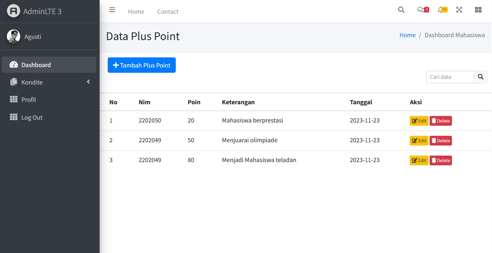
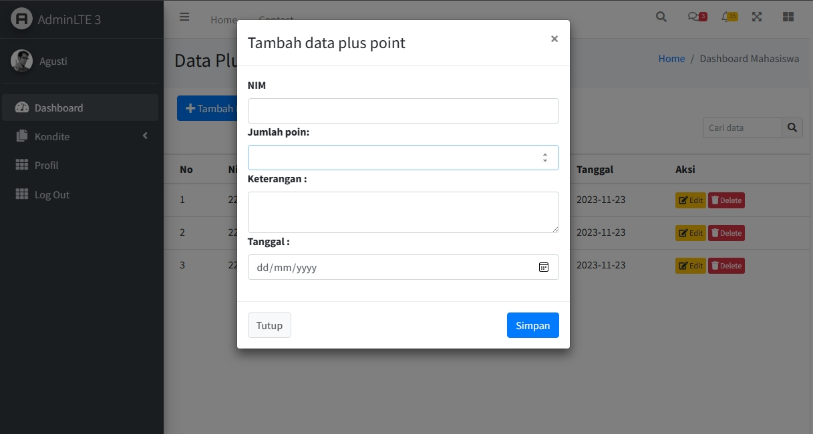
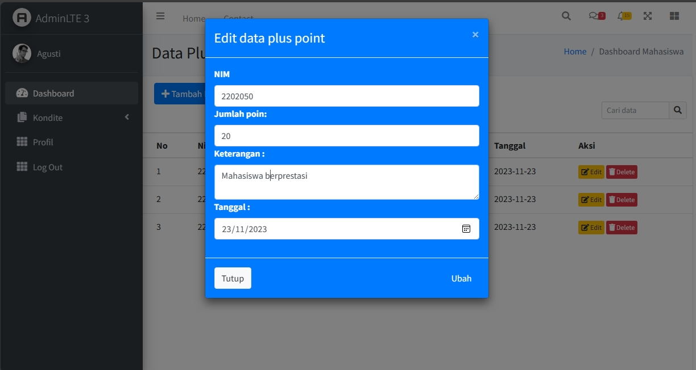
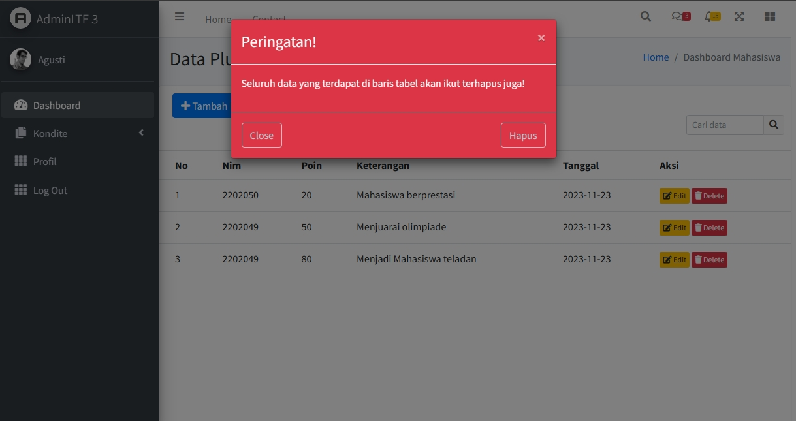

# CRUD - AdminLTE 📊

[](https://opensource.org/licenses/MIT)
[](https://github.com/racommit/CRUD-AdminLTE/stargazers)
[](https://github.com/racommit/CRUD-AdminLTE/network)
[](https://github.com/racommit/CRUD-AdminLTE/issues)

**A Student Points Management System with CRUD Functionality and AdminLTE Dashboard Integration.**

CRUD - AdminLTE is a web-based application designed to manage student points through a centralized administrative dashboard.

Built using the AdminLTE dashboard template, which is based on Bootstrap, this project provides a responsive and user-friendly interface for managing student point records.

The application focuses on implementing fundamental CRUD (Create, Read, Update, Delete) operations, allowing administrators to efficiently manage student data and their associated points.

## 📑 Table of Contents

- [Overview](#overview)
- [Demo](#demo)
- [Features](#features)
- [Technologies Used](#technologies-used)
- [Installation](#installation)
- [Usage](#usage)
- [Project Structure](#project-structure)
- [License](#license)

## 📖 Overview

Managing student points manually can become inefficient when dealing with multiple records.

This project provides a simple administrative solution that allows users to manage student point data through a web-based interface.

By integrating AdminLTE, the application offers a structured dashboard layout with a consistent visual experience.

## 🖥️ Demo

The following screenshots showcase the application's interface and CRUD functionality.

### Dashboard



### Add Student Points



### Update Student Points



### Delete Student Points



## ✨ Features

The application provides the following functionality:

- **User Authentication** – Login functionality to restrict access to the administrative application.
- **Create Records** – Add new student point records.
- **Read Records** – Display and review existing student point data.
- **Update Records** – Modify existing student point information.
- **Delete Records** – Remove student point records.
- **AdminLTE Integration** – A responsive administrative dashboard interface.
- **Bootstrap Integration** – Consistent styling and responsive layouts.

## 🛠️ Technologies Used

| Technology | Purpose |
|---|---|
| PHP | Backend application logic |
| MySQL | Database management |
| AdminLTE | Administrative dashboard template |
| Bootstrap | Responsive UI framework |
| HTML5 | Web page structure |
| CSS3 | Interface styling |
| JavaScript | Client-side functionality |

## 🚀 Installation

Follow these steps to set up the application locally.

**Prerequisites:**
- PHP-compatible local server environment (XAMPP, Laragon, or similar).
- MySQL or MariaDB.
- Web browser.
- AdminLTE distribution files and required plugins.

### 1. Clone the Repository

```bash
git clone https://github.com/racommit/CRUD-AdminLTE.git
